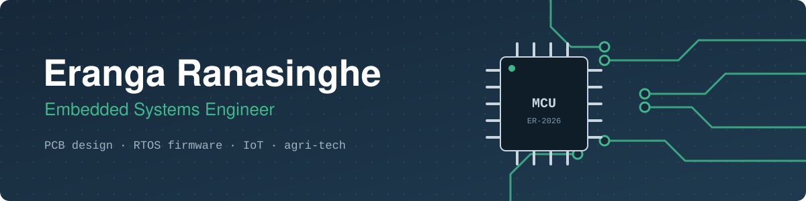

# Hi, I'm Eranga Ranasinghe 👋

**Senior Embedded Systems Engineer** at Azend Technologies, Colombo, Sri Lanka.
I design PCBs, write firmware and build IoT systems, with 4+ years of hands-on hardware and firmware work, mostly in agri-tech.

- 🌱 Building the electronics behind **govi.ai**, an agricultural IoT and SaaS platform for sensing, data acquisition and farm automation
- 🔧 Designing commercial 2-layer PCBs in KiCad (down to 0402 parts) and writing RTOS firmware for ESP32/ESP8266 boards
- 🔭 Astronomy and astrophotography enthusiast, former observer and tutor at the Institute of Astronomy Sri Lanka
- 📫 Reach me: erangaranasinghe125@gmail.com

## Tech I use

**Languages**

**Microcontrollers and firmware**

**Hardware design and tools**

**Protocols:** I2C · SPI · UART · RS485 · Modbus · ADC · PWM · LoRa · MQTT / AWS IoT Core

## Things I've built

| Project | What it is |
|---|---|
| **Low-cost auto-guiding system for telescope mounts** | Vision-based star tracking (Lucas-Kanade optical flow in Python) driving a microcontroller-controlled mount. Published 2021. |
| **TinyWire for ATtiny85** | C library for software I2C between ATtiny85 and sensors, plus a UART-based RS485 library |
| **Agriculture drone** | Autonomous drone with a chemical spraying system for large fields, shown at Shilpa Sena 2019 |
| **Electromechanical sea wave power unit** | Renewable energy generator, 2nd place at IESL Techno Exhibition 2017 |
| **Battle robot** | High-power, low-weight robot, final 8 at Uva Wellassa University robot battle 2019 |
| **Line-following and obstacle-avoiding robots** | Arduino robots with industrial sensors, SLIIT Robofest 2017 and 2018 |

## Recognition

- 🥉 **2nd Runner-Up, Agri-Tech Innovation**, SLASSCOM Ingenuity Awards 2024 (govi.ai)
- 🥈 **Silver, Industrial Category**, 25th National ICT Awards NBQSA 2023 (govi.ai)

## GitHub stats

## Connect

